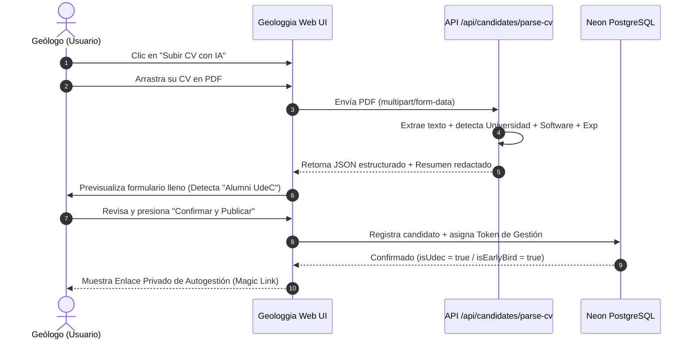

# Manual Técnico y Operativo: GEOLOGGIA EMPLEOS
**Plataforma Autónoma de Empleo y Red de Talentos en Geociencias de Chile**  
*Desarrollado para Geologgia Consultores & Comunidad Alumni Geología Universidad de Concepción (UdeC)*

---

## 1. Resumen Ejecutivo del Proyecto

**Geologgia Empleos** ([https://empleos.geologgia.cl](https://empleos.geologgia.cl) · Repositorio: [github.com/kvil2025/geologgia-empleos](https://github.com/kvil2025/geologgia-empleos)) es una aplicación web progresiva y directorio laboral diseñado para resolver dos necesidades críticas del mercado minero y geocientífico en Chile:

1. **Para Empresas y Contratistas:** Un canal directo, sin burocracia y sin costo para publicar vacantes mineras (turnos 7x7, 4x3, faena, campamento) y acceder a una red verificada de geólogos, geotécnicos y modeladores.
2. **Para Geólogos y Colegas:** Un portal donde pueden subir su CV en PDF para que un motor de IA extraiga y sintetice su perfil profesional de forma automática, segmentando el acceso preferencial para egresados de la **Universidad de Concepción (Alumni UdeC)** y otorgando cupos gratuitos para los primeros 100 geólogos foráneos.
3. **Para el Ecosistema Tecknologia / Geologgia:** Actúa como embudo orgánico hacia **SOSCARD Pro**, ofreciendo protección financiera ante asaltos y pérdida de celular en traslados a faena o campamento.

---

## 2. Experiencia de Usuario (Cómo Funciona en la Práctica)

### A. Para el Geólogo Postulante (Flujo 100% Autónomo)



1. **Subida del Documento:** El usuario no tiene que escribir su experiencia manualmente; sólo arrastra su PDF.
2. **Extracción en Segundos:** El motor lee el documento y detecta su nombre, título, universidad, software (`Leapfrog`, `Vulcan`, etc.), años de carrera y genera un resumen ejecutivo profesional.
3. **Distinción UdeC:** Si el CV contiene mención a la *Universidad de Concepción* o su correo es `@udec.cl`, el sistema le otorga inmediatamente la credencial dorada `🎓 Alumni Geología UdeC`.
4. **Cupo Gratuito Early Adopter:** Si proviene de otra universidad, el sistema comprueba los cupos disponibles (1 a 100) y le asigna membresía gratuita vitalicia.
5. **Magic Link de Autogestión:** Al finalizar, el colega recibe un enlace único (`/autogestion?token=...`).

### B. Para la Autogestión del Colega (`/autogestion`)

Cuando el colega encuentra trabajo o cambia sus condiciones de disponibilidad:
1. Abre su enlace privado en el celular o computador.
2. **Botón de Pausa en 1 toque:** Puede hacer clic en *«Pausar Perfil (Ya tengo pega)»*. De inmediato, su ficha desaparece del directorio público para que no sigan llamándolo.
3. **Reactivación Inmediata:** Cuando termine su turno o proyecto, entra al mismo link y presiona *«Reactivar mi Perfil»*.
4. **Cambio de Turno:** Puede actualizar su disponibilidad (ej. pasar de 7x7 a 4x3 o faena norte).

### C. Para Reclutadores y Verificación de Usuarios (Sistema OTP 6 Dígitos)

Para resolver definitivamente el problema de errores tipográficos (como escribir por error `cavila1971@gmial.com`) y evitar que personas malintencionadas usen correos de terceros o bots:
1. **Detección Activa de Typos:** Si un usuario escribe un dominio con error conocido (`@gmial.com`, `@hotmial.com`, `@outlok.com`), el sistema lo detecta instantáneamente y le sugiere la corrección con un solo clic.
2. **Despacho de Código OTP:** El backend genera un código criptográfico de 6 dígitos numéricos con vencimiento estricto de 10 minutos (`/api/auth/otp/send`) y lo envía a la bandeja del usuario.
3. **Validación en Base de Datos:** El usuario ingresa los 6 dígitos en la interfaz (`/api/auth/otp/verify`). Al coincidir, el sistema sella la sesión con un token seguro en `geologgia_empleos.EmailVerification` y activa la insignia dorada/esmeralda `✓ Verificado`.
4. **Protección Brute-Force:** Se bloquea el código automáticamente tras 5 intentos erróneos y existe un cooldown de 45 segundos para reenvíos.
5. **Acceso a Contacto & Descarga:** Tanto el registro como la visualización de contactos protegidos en el directorio exigen estar verificado por este mecanismo.

---

## 3. Arquitectura Técnica y Desarrollo

```
                    ┌──────────────────────────────────────────────┐
                    │               CLIENTE (BROWSER)              │
                    │  Next.js 16 (App Router) + Tailwind CSS v4   │
                    │  Estética Jaime Aza: Bento Dark Minimalist   │
                    │  Interactive Hero Canvas (Constelación Sub)  │
                    └──────────────────────┬───────────────────────┘
                                           │
                        HTTPS / JSON / Form-Data
                                           │
                    ┌──────────────────────▼───────────────────────┐
                    │            VERCEL SERVERLESS EDGE            │
                    ├──────────────────────────────────────────────┤
                    │ • /api/candidates/parse-cv (Extractor PDF)   │
                    │ • /api/candidates          (Listar/Crear)    │
                    │ • /api/candidates/manage   (Autogestión)     │
                    │ • /api/jobs                (Ofertas faena)   │
                    └──────────────────────┬───────────────────────┘
                                           │
                          Prisma ORM (Connection Pooler)
                                           │
                    ┌──────────────────────▼───────────────────────┐
                    │          NEON POSTGRESQL (AWS IAD)           │
                    │  Database: neondb                            │
                    │  Schema:   geologgia_empleos  [AISLADO]      │
                    │  Tables:   Candidate, Job                    │
                    └──────────────────────────────────────────────┘
```

### A. Stack Tecnológico

| Capa | Tecnología | Detalle |
| :--- | :--- | :--- |
| **Framework** | Next.js 16.1.6 (Turbopack) | Arquitectura App Router, Serverless Functions |
| **Frontend** | React 19.2 + Tailwind CSS v4 | Estética Bento Grid inspirada en Jaime Aza |
| **Tipografía** | `Inter` + `JetBrains Mono` | Interfaz limpia con acentos técnicos de precisión |
| **Base de Datos** | Neon Serverless PostgreSQL | Alojado en AWS East (N. Virginia), pooler activo |
| **ORM** | Prisma v5.22.0 | Esquema aislado `geologgia_empleos` |
| **Parser PDF** | `pdf-parse` (v2 class engine) | Procesamiento en memoria de streams binarios |
| **Hosting & CI/CD**| Vercel Production | Despliegue automático conectado al dominio oficial |
| **Telemetría** | Umami v3.4.0 (Soberana) | Seguimiento de visitas sin cookies invasivas |

---

### B. Esquema de Datos Prisma (`schema.prisma`)

El esquema está estrictamente aislado en el namespace `geologgia_empleos` para proteger la base de datos de producción:

```prisma
model Candidate {
  id              String   @id @default(cuid())
  fullName        String
  title           String
  university      String?  @default("Universidad de Concepción")
  isUdec          Boolean  @default(false)
  isEarlyBird     Boolean  @default(true)
  yearsExp        Int      @default(1)
  specialties     String
  preferredShift  String   @default("7x7")
  preferredRegion String   @default("Norte Grande")
  summary         String   @db.Text
  linkedinUrl     String?
  phone           String?
  email           String
  cvUrl           String?  @db.Text
  cvFileName      String?
  status          String   @default("ACTIVE") // ACTIVE | PAUSED
  managementToken String?  // Token privado para autogestión
  createdAt       DateTime @default(now())
  updatedAt       DateTime @default(now()) @updatedAt

  @@index([title])
  @@index([status])
  @@index([isUdec])
  @@index([managementToken])
}

model EmailVerification {
  id        String   @id @default(cuid())
  email     String
  code      String   // Código de 6 dígitos numéricos
  token     String   @unique
  verified  Boolean  @default(false)
  attempts  Int      @default(0)     // Límite de 5 intentos contra fuerza bruta
  expiresAt DateTime                 // Validez estricta de 10 minutos
  createdAt DateTime @default(now())

  @@index([email])
  @@index([token])
  @@index([code])
}
```

---

### C. Motor de Extracción NLP de Geociencias (`src/lib/cv-parser.ts`)

El archivo [cv-parser.ts](file:///C:/Users/geolo/.gemini/antigravity/scratch/geologgia-empleos/src/lib/cv-parser.ts) implementa la lógica de extracción de dominio:

1. **Detección Universitaria:**
   - Patrones RegExp para: `Universidad de Concepción`, `UdeC`, `Universidad de Chile`, `UCN`, `UDA`, `PUC`, `UNAB`, etc.
   - Si el correo electrónico termina en `@udec.cl` o `@alumnos.udec.cl`, clasifica automáticamente como Alumni UdeC.
2. **Cálculo de Años de Trayectoria:**
   - Escanea menciones cronológicas de titulación y empleos (ej: `2018 - 2024`, `2015 a la fecha`) calculando la antigüedad en relación al año actual (2026).
3. **Diccionario Geológico Minero:**
   - Detecta palabras clave de software especializado: `Leapfrog Geo`, `Maptek Vulcan`, `Datamine`, `IoGAS`, `QGIS`, `ArcGIS Pro`.
   - Detecta metodologías de terreno: `Sondajes DDH`, `Sondajes RC`, `QA/QC`, `Mapeo Lito-Estructural`, `Logueo de Testigos`, `Geotecnia Rajo/Subterránea`.
4. **Síntesis Ejecutiva:**
   - Genera automáticamente un párrafo fluido de presentación profesional para evitar que el candidato tenga que redactarlo desde cero.

---

### D. Seguridad, Verificación OTP y Cumplimiento Legal (Chile)

1. **Anti-Scraping & Gatekeeper Verificado:**
   * Para ver teléfonos directos o descargar el PDF original del CV, el usuario debe haber validado su identidad mediante un código OTP de 6 dígitos enviado a su correo.
2. **Detección de Typos:**
   * El sistema detecta y corrige automáticamente errores frecuentes de digitación como `cavila1971@gmial.com`.
3. **Blindaje OWASP & Cabeceras:**
   * `X-Frame-Options: DENY`, `X-Content-Type-Options: nosniff`, `HSTS` y omisión de tokens en respuestas JSON públicas.
4. **Cumplimiento Ley N° 19.628 y Nueva Ley de Protección de Datos Personales:**
   * Casilla de consentimiento explícito no premarcada para postulantes.
   * Botón de **Pausa de Perfil en 1 toque** cuando el geólogo encuentra trabajo.
   * Botón de **Derecho al Olvido (Eliminación Definitiva)** en `/autogestion` respaldado por `DELETE /api/candidates/manage`.
   * Disclaimer legal y modal explicativo de derechos ARCO accesible desde el pie de página.

---

## 4. Direcciones y URLs en Producción

* **Portal Principal de Empleos:** [https://empleos.geologgia.cl](https://empleos.geologgia.cl)
* **URL Alternativa Vercel:** [https://geologgia-empleos.vercel.app](https://geologgia-empleos.vercel.app)
* **Ruta de Autogestión:** `https://empleos.geologgia.cl/autogestion?token={TOKEN_DEL_USUARIO}`
* **Consola de Telemetría:** [https://tecknologia-analytics.vercel.app](https://tecknologia-analytics.vercel.app)
  * Sitio ID: `f14eb68d-6ded-4d75-9eb6-469e774e8a8f`

---

## 5. Panel de Control Maestro y Moderación (`/admin`)

Para que el dueño y administrador de Geologgia Empleos pueda moderar y dar de baja contenido en tiempo real sin tocar código ni la base de datos:

* **URL de Acceso:** **[https://empleos.geologgia.cl/admin](https://empleos.geologgia.cl/admin)**
* **Mecanismos de Acceso:**
  1. **Clave Maestra / PIN:** `geologgia2026!` (configurable en `ADMIN_SECRET_KEY`).
  2. **Sesión OTP Verificada:** Si tienes sesión iniciada como `cavila1971@gmail.com` en el portal, el panel reconoce tu token automáticamente como Superadmin.

### A. Funciones de Moderación de Postulantes (CVs)
* **Dar de Baja / Pausar (1 Clic):** Cambia el estado a `PAUSED`. La ficha desaparece inmediatamente del directorio público pero se conserva en el panel por si el colega vuelve a buscar pega.
* **Reactivar:** Si un perfil pausado vuelve a requerir visibilidad, un clic en "Reactivar" lo restaura en el portal público.
* **Eliminación Definitiva:** Purgado total e irreversible del registro, datos y PDF en la base de datos (con modal de confirmación).
* **Moderar Distinción UdeC:** Botón de 1 clic para otorgar o revocar la credencial dorada `🎓 Alumni UdeC`.
* **Revisión de CV PDF:** Enlace directo para abrir y verificar el documento adjunto.

### B. Funciones de Moderación de Ofertas Laborales (Jobs)
* **Cerrar Vacante:** Pasa el aviso a estado `CLOSED` para que deje de recibir postulaciones en el portal público.
* **Destacar Vacante:** Fija la oferta en las primeras posiciones con distintivo dorado.
* **Eliminar Oferta:** Borra definitivamente vacantes caducadas o spam.

---

## 6. Mantenimiento y Operaciones Futuras

1. **Para agregar nuevas ofertas manualmente:**
   - Cualquier persona o administrador puede hacer clic en **"Publicar Oferta"** en el encabezado. La vacante queda disponible al instante en la base de datos sin requerir compilación.
2. **Para respaldar o exportar la base de postulantes:**
   - Al estar en Neon PostgreSQL (schema `geologgia_empleos`), la tabla `Candidate` se puede consultar con cualquier cliente SQL o exportar a CSV/Excel cuando se requiera.
3. **Escalabilidad de Cupos:**
   - La constante `TOTAL_FREE_SLOTS = 100` en [route.ts](file:///C:/Users/geolo/.gemini/antigravity/scratch/geologgia-empleos/src/app/api/candidates/route.ts) puede modificarse o ampliarse cuando se alcance la meta inicial.
